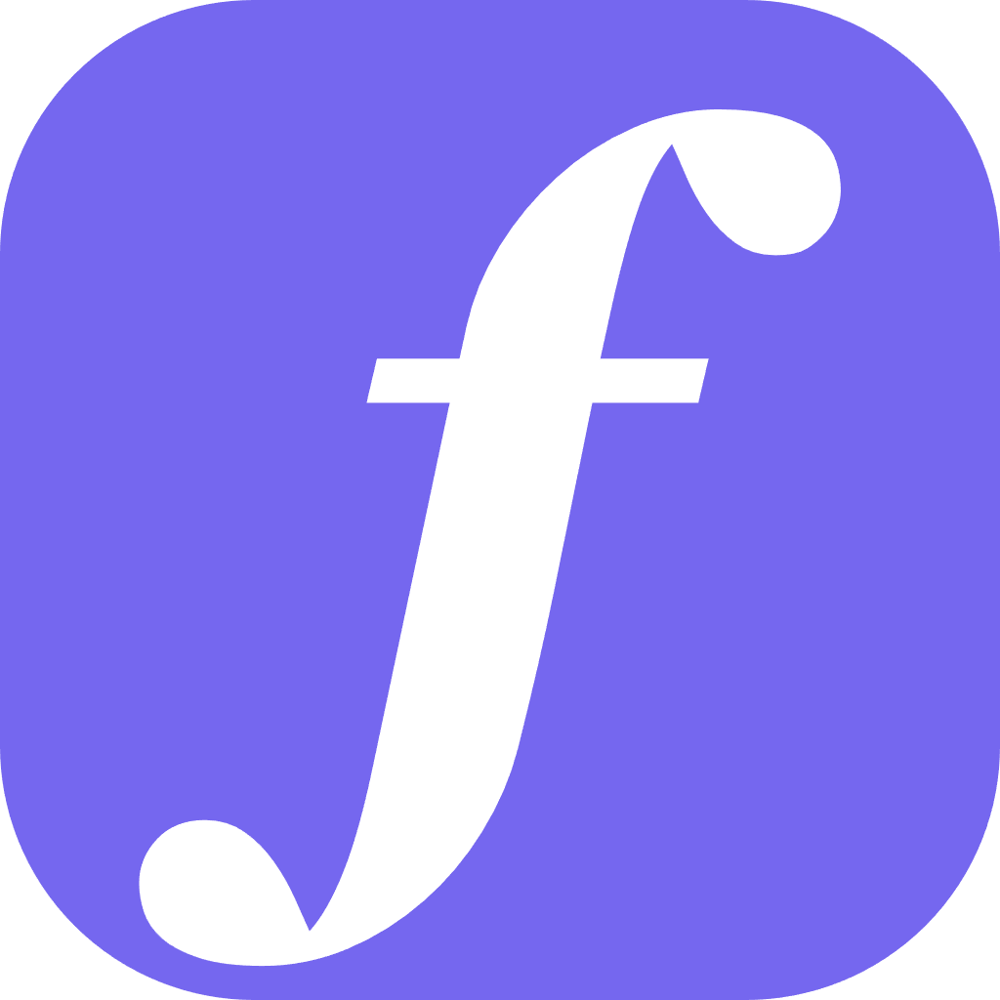

<div align="center">



<h1>FASK</h1>

<p><strong>화면에서 질문하고, 배운 것을 내 지식으로.</strong></p>

<p>화면 위의 질문부터 AI 답변, 연결된 지식까지 담는 개인용 데스크톱 워크스페이스입니다.</p>

<p>
  <a href="https://github.com/KyungMinseo1/FASK/releases"></a>
  <a href="mobile/"></a>
  <a href="desktop/package.json"></a>
  <a href="#데이터와-개인정보"></a>
</p>

<p>
  <a href="https://github.com/KyungMinseo1/FASK/releases"><strong>다운로드</strong></a>
  &nbsp;·&nbsp;
  <a href="#시작하기">시작하기</a>
  &nbsp;·&nbsp;
  <a href="#개발자-가이드">개발자 가이드</a>
</p>

<sub><a href="README.md">English</a> &nbsp;|&nbsp; <strong>한국어</strong></sub>

</div>

<br />

> 화면에 **표시**하고 &nbsp;→&nbsp; 그 자리에서 **질문**하고 &nbsp;→&nbsp; 답변을 맥락과 함께 **보관**합니다.

---

## 설치하고 사용하기

> **일반 사용자는 [Releases](https://github.com/KyungMinseo1/FASK/releases)의 Windows 설치 버전을 사용하세요.** 소스 설치는 개발할 때만 필요합니다.

1. **Releases**에서 Windows 설치 파일이 첨부된 릴리스를 엽니다.
2. **Assets**에서 `setup.exe` 설치 파일을 다운로드합니다. 현재 설정된 파일명은 `fask-<version>-setup.exe`입니다.
3. 설치 파일을 실행하고 **FASK**를 엽니다.
4. [시작하기](#시작하기)에 따라 OpenAI 호환 API를 연결합니다.

Windows 설치 파일을 배포할 예정입니다. 아직 설치 파일이 없는 릴리스라면 업로드를 기다려 주세요. GitHub의 **Source code** ZIP/TAR 파일은 설치 파일이 아닙니다.

**설치 버전은 FASK 로그인, Node.js, Python, 별도 DB 설치가 필요 없습니다.** AI 답변에는 OpenAI 호환 API endpoint(서비스가 요구하면 API 키)가 필요합니다.

## 무엇을 할 수 있나요?

| 질문을 포착하기 | 내 지식으로 쌓기 |
| --- | --- |
| 투명 펜·지우개 오버레이로 화면에 표시 | **프로필 → 워크스페이스 → 프로젝트**로 기록 정리 |
| 질문에 포함할 화면 영역을 직접 선택 | **Markdown·LaTeX**를 지원하는 실시간 답변 |
| 이미지와 텍스트·코드 파일 첨부 | 질문 검색, 메모 작성, 개념 연결 |
| 화면을 떠나지 않고 대화 이어가기 · 이어서 한 질문은 하나의 질문으로 저장 | 개념 그래프 탐색과 Markdown 기억 내보내기 |

## 시작하기

### 1. AI 연결

FASK는 **OpenAI 호환 API**(`/v1/models`, `/v1/chat/completions`)를 지원합니다. OpenAI API는 물론 호환 게이트웨이나 로컬 서버도 사용할 수 있습니다.

1. FASK **설정 · AI 연결**에서 endpoint를 입력합니다. 예: `https://api.openai.com/v1`, `http://127.0.0.1:8317/v1`.
2. 서비스가 요구하면 **API 키**를 입력합니다. 키는 OS 보안 저장소로 암호화하며 백업에는 포함되지 않습니다.
3. **연결 확인 · 모델 불러오기**를 누르고 기본·빠른·깊은 추론 모델을 선택한 뒤 저장합니다.

로컬 기록 조회와 수동 정리는 AI 연결 없이도 사용할 수 있습니다.

### 2. 캡처 영역 설정

**캡처 영역 설정**에서 모니터와 사각형 범위를 선택합니다. 박스를 이동하거나 8방향 손잡이로 크기를 조절하세요. 선택한 영역은 선명하게, 바깥은 어둡게 표시합니다.

편집 창과 펜 오버레이는 작업표시줄 영역을 포함한 동일한 전체 모니터 좌표계를 사용합니다. 펜 모드의 점선은 설정한 캡처 범위를 나타냅니다.

모니터와 영역은 편집 화면에서 **적용**을 눌러야 저장됩니다. 저장한 모니터가 사라지거나 화면 크기가 바뀌면 화면 질문·이어서 질문·단축키가 전체 화면으로 대신 캡처하지 않고 **캡처 영역 다시 설정**으로 안내하며, 작성 중인 질문과 첨부는 유지됩니다. 모니터나 크기가 바뀐 상태로 적용하면 이전 펜 표시만 지워집니다.

### 3. 화면에서 질문

프로젝트에서 **화면에서 질문**을 누르고 필요한 부분을 표시합니다. **화면 캡처 포함** 여부를 선택한 뒤 **질문하기**를 누르세요.

- 화면은 **전송하는 순간** 캡처합니다. 체크를 바꾸거나 질문을 다듬을 때에는 촬영하지 않습니다.
- API 요청 실패 시 펜 획과 질문 초안을 유지합니다. 펜은 성공 완료 후 지웁니다.
- 실시간 패널·저장된 상세·대시보드 미리보기에서 굵게·기울임·목록·코드·표·LaTeX를 지원합니다.

### Android 동반 앱

데스크톱 **설정 → 모바일 연결**에서 허브를 켜고 접근 가능한 LAN 또는 Tailscale 주소를 선택하거나, 중계 서버 연결을 켜 Tailscale 없이 외부에서 연결한 뒤 Android 앱에서 QR을 스캔합니다. 중계 서버는 종단 간 암호화된 데이터만 전달합니다. PC가 켜져 있어야 하며 현재 PC 프로필과 AI 연결을 사용합니다. QR은 비밀번호처럼 취급하고, 기존 휴대폰 연결을 취소하려면 페어링을 초기화하세요.

네이티브 앱은 PC 인증서를 고정 검증하고 연결 비밀을 보안 저장소에, 오프라인 스냅샷을 암호화해 저장합니다. 오프라인에서는 저장 기록을 읽을 수 있지만 AI 요청에는 PC 연결이 필요합니다. 촬영·사진 첨부와 Android 텍스트·이미지 공유를 질문 작성에 사용할 수 있습니다.

JDK 21과 Android SDK 36을 준비하고 `mobile/`에서 `npm ci`, `npm run apk`를 실행합니다. APK 경로는 `mobile/android/app/build/outputs/apk/debug/app-debug.apk`입니다. 클라이언트·캐시 검증은 `npm test`, 네이티브 전송 검증은 `npm run test:android`입니다. 에뮬레이터용 `npm run apk:test`만 페어링 링크 직접 입력을 제공하며 일반 빌드는 QR을 사용합니다. 브라우저 `npm run dev`는 개발 전용으로 인증서 고정 검증을 하지 않습니다.

Android 런처 아이콘과 스플래시 화면은 Windows의 `desktop/build/icon.png`를 원본으로 사용하며 적응형·원형 아이콘도 함께 제공합니다. Windows 아이콘을 변경하면 `desktop/`에서 `npx electron ../mobile/generate-icons.cjs` 실행 후 APK를 다시 빌드하세요. 외곽 모양은 Android 런처가 결정합니다.

### 단축키와 오버레이 조작

| 조작 | 동작 |
| --- | --- |
| `Ctrl+Shift+Space` | 현재 프로젝트의 오버레이 열기 / 질문 패널 토글 |
| `Ctrl+Alt+Space` | 기본 키가 점유된 경우 대체 키. 실제 등록된 키는 사이드바에 표시 |
| `Esc` | 펜 모드 해제 |
| 패널 헤더 / 모서리 손잡이 | 패널 이동 / 크기 조절. 위치와 크기 기억 |
| 다른 앱 클릭 | 해당 앱으로 포커스 이동과 동시에 질문 패널 닫기. 오버레이는 유지 |

열린 패널에서 마우스만 벗어나면 닫히지 않습니다. 패널이 닫히고 펜이 유휴 상태일 때 도구 밖으로 나가면 FASK 자신의 키보드 포커스를 해제하며 다른 앱을 강제로 활성화하지 않습니다.

<details>
<summary><strong>첨부, 선택적 AI 기능, 탐색 자세히 보기</strong></summary>

- **첨부:** 파일 선택, 드래그 앤 드롭, 이미지 붙여넣기. 이미지 1장(PNG/JPEG/WebP/GIF)과 텍스트·Markdown·코드 파일 최대 5개를 지원합니다. 파일당 50,000자, 합계 100,000자이며 PDF 등 바이너리 문서는 지원하지 않습니다.
- **선택적 AI:** 질문 다듬기, 모델 추천·자동 선택, 개념 정리, 제목 자동 생성을 각각 켜고 끌 수 있습니다. 새 질문은 질문 문장·이미지·첨부 파일을 근거로 답변과 병렬로 AI 제목을 만들며, 사용자가 직접 바꾼 이름이 항상 우선합니다. 자동 개념 정리는 추가 모델 요청을 사용합니다. 질문이 물은 개념은 태그로, 답변이 끌어온 개념은 관련 개념으로 연결하고, 아직 개념이 아닌 용어는 다른 질문에서 다시 나올 때까지 후보로 둡니다. 관계는 근거가 되는 답변 문장이 있을 때만 저장합니다. 정리 검토는 흡수·병합·이름 정리·태그 재판정과 다른 워크스페이스에 맞는 질문의 이동을 제안하며, 승인한 항목만 반영합니다. 중요 질문은 같은 프로젝트의 이후 질문에 참고할 수 있습니다.
- **정리 검토:** 모델 호출 전에 후보 이름을 확인할 수 있습니다. 입력 토큰 수는 문자 수를 3으로 나눈 추정치이며 출력 토큰은 제외합니다. 작업은 워크스페이스 소유 PC에서 계속 실행되므로 창을 닫아도 됩니다. 데스크톱의 **알림**에서 완료된 정리안을 다시 엽니다. 체크한 항목은 적용하고, 체크하지 않은 항목은 이번에만 건너뛰며 다음 정리에 다시 나옵니다. 휴지통의 **이 상태로 두기**는 현재 상태를 검토 완료로 기록합니다.
- **다른 PC의 지식 관리자:** 연결만으로는 상대 워크스페이스를 정리할 수 없습니다. 정리 창에서 관리자 등록을 요청하면 소유 PC의 알림에서 수락·거절할 수 있고, **설정 → 다른 PC 연결 → 연결된 PC**에서 지정·해제할 수 있습니다. 휴대폰은 연결한 PC의 권한을 따릅니다. 관리자 권한은 재시작 후에도 유지되지만 진행 중·검토 대기 정리안은 소유 PC의 메모리에만 있으므로 재시작하면 사라집니다. 이 기기의 알림 감시 목록은 로컬에 남아 작업 중단을 알립니다.
- **대화:** 이어서 한 질문은 원래 질문의 대화 항목으로 저장되어 대시보드·검색·그래프·백업에서 대화 하나가 기록 하나로 보입니다. 질문 상세에는 대화 항목마다 답변·첨부·모델이 순서대로 표시됩니다.
- **탐색:** **내 공간 / 워크스페이스 / 프로젝트** 경로와 뒤로가기를 사용합니다. 워크스페이스 선택 아래에서 이름을 바꾸거나 프로젝트 제목 옆 연필 버튼으로 수정합니다.
- **지식 보기:** 날짜순·목록·개념 그래프, 텍스트 검색, 복잡도 필터, 메모, 개념 연결.
- **기록 이동:** **기억 내보내기**는 다른 AI 세션에 첨부할 Markdown을 만듭니다. 설정에서 이미지를 포함한 JSON 백업을 생성하며 복원은 별도 프로필을 만듭니다. 접속 키는 제외합니다. 1.0.x 백업은 대화마다 하나의 질문으로 합쳐 가져옵니다.

</details>

## 데이터와 개인정보

| 항목 | 위치 / 동작 |
| --- | --- |
| 질문·답변·설정 | Electron `userData/personal/fask.sqlite` |
| 이미지 | `userData/personal/attachments/` |
| Windows 기본 폴더 | `%APPDATA%/fask/personal/` |
| 프로필 분리 | 하나의 로컬 DB 안에서 논리적으로 구분. OS 수준 격리는 아님 |
| 1.1.0 업그레이드 | 처음 실행할 때 1.0.x 대화를 하나의 질문으로 합칩니다. 변경 전 DB는 `fask.sqlite` 옆 `fask-pre-1.1.0.sqlite`로 보존 |
| AI 요청 | 설정한 OpenAI 호환 endpoint로 전송. 로컬 저장이 **오프라인 AI**를 뜻하지는 않음 |

원본 답변은 Markdown으로 보존합니다. 별도 수업용 백엔드는 필요하지 않습니다.

---

## 개발자 가이드

> FASK를 수정하거나 소스에서 실행할 때의 안내입니다. 일반 사용자는 위의 **Releases 설치 버전**을 사용하세요.

### 소스에서 실행

필수 도구는 **Node.js 22.13 이상**과 npm입니다. 모델 응답을 사용하려면 OpenAI 호환 API endpoint가 필요합니다. SQLite는 Electron 내장 `node:sqlite`를 사용하므로 Python이나 DB 서버는 필요하지 않습니다.

```powershell
git clone https://github.com/KyungMinseo1/FASK.git
cd FASK/desktop
npm ci
npm run dev
```

개발 버전은 동일한 개인용 앱을 소스에서 실행합니다. [시작하기](#시작하기)의 AI 연결 설정은 별도로 필요합니다.

### 검사와 Windows 패키징

`desktop/`에서 실행합니다.

| 명령 | 용도 |
| --- | --- |
| `npm test` | 단위 테스트 |
| `npm run typecheck` | main·preload·renderer TypeScript 검사 |
| `npm run build` | 타입체크와 프로덕션 빌드 |
| `npm run test:smoke` | 빌드, 실제 Electron UI 스모크, 재시작 검사 |
| `npm run build:unpack` | 설치하지 않고 실행할 앱 폴더 빌드 |
| `npm run build:win` | NSIS 설치 파일을 포함한 Windows 배포 파일 빌드 |

생성한 `fask-<version>-setup.exe`를 GitHub 릴리스의 **Assets**에 업로드합니다. 사용자는 소스 압축 파일이 아닌 이 설치 파일을 다운로드합니다.

통합 스모크는 로컬 가짜 OpenAI 호환 서버와 고정 캡처 이미지를 사용하며 실제 공급자 계정이나 다른 앱의 화면을 전송하지 않습니다. 다중 모니터·DPI 조합과 계정별 이미지 지원은 환경별 추가 확인이 필요합니다.

<details>
<summary><strong>파일 구조 펼치기</strong></summary>

```text
desktop/                     Electron + React + TypeScript + Tailwind
  src/main/
    index.ts                 앱 진입점과 메인 창
    profile.ts               --profile → 별도 userData 폴더
    personal.ts              personal:* IPC 핸들러와 서비스 연결
    personal-store.ts        로컬 SQLite 레코드·설정·실행 기록·마이그레이션
    personal-capture.ts      오버레이·캡처 영역 편집기·화면 캡처
    personal-shortcuts.ts    전역 단축키 등록과 대체 키
    personal-backup.ts       JSON 백업·복원
    local-api.ts             OpenAI 호환 스트리밍·모델 클라이언트
  src/preload/               window.fask 브리지와 personal.d.ts 계약
  src/shared/questions.ts    main·renderer가 함께 쓰는 질문·대화 항목 함수
  src/renderer/src/
    App.tsx                  대시보드, /personal-overlay, /capture-editor
    personal/                화면·입력창·Markdown·첨부·펜 획
    components/MindMap/      React Flow + d3-hierarchy 개념 그래프
    lib/, api/types.ts       트리 도우미와 공용 타입
  tests/                     단위 테스트와 Electron 스모크
  build/, resources/         아이콘·entitlements·아이콘 생성 스크립트
mobile/                      Capacitor 기반 Android 동반 앱
relay/                       종단 간 암호화 원격 연결용 Cloudflare 중계 서버
graphify-out/                코드 그래프 분석 결과
```

</details>

> MCP, 임베딩 검색, JEV는 후속 범위이며 현재 제공하는 기능은 아닙니다.
